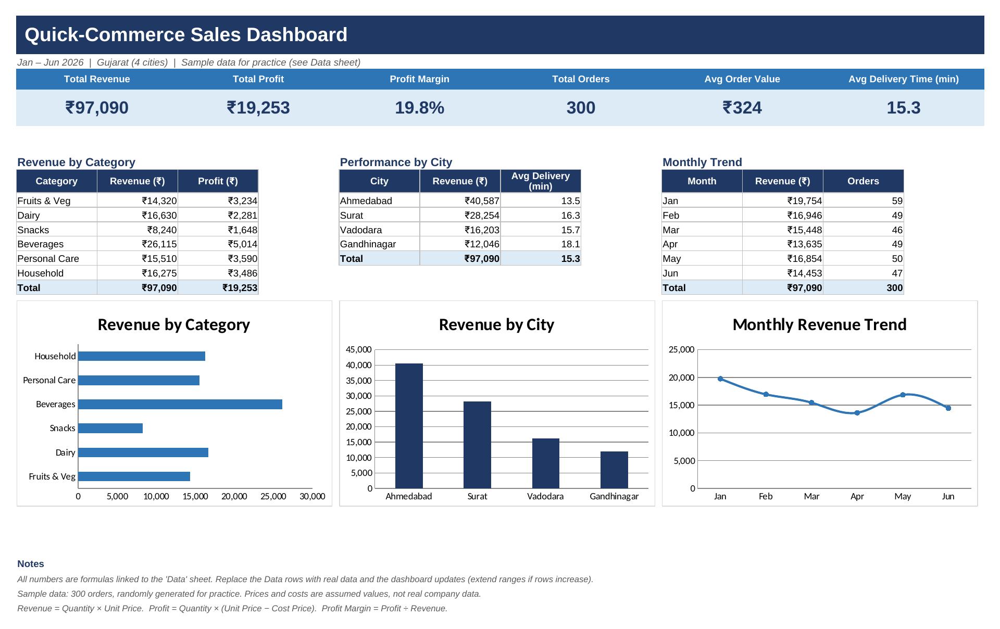
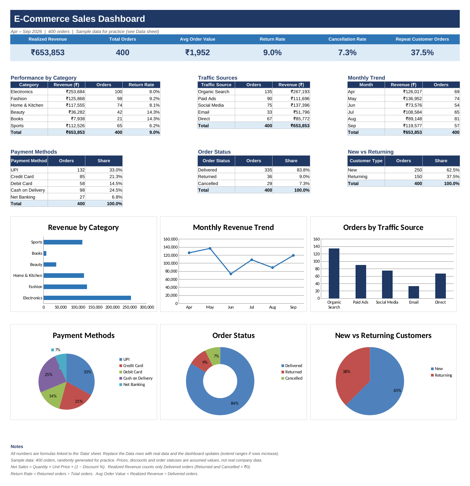

# Data Analyst Portfolio

Hi, I'm **Balmiki Kumar**, an aspiring Data Analyst. I'm pursuing a BBA (2026-2029) and work in retail store operations, where I deal with stock, inventory and team coordination every day. I'm building my data skills in **Excel, SQL, Power BI and Python**, and this repository shows the projects I've built so far.

> **Note:** All projects use **sample data that I generated for practice**. The numbers are not from any real company.

---

## Project 1: Quick-Commerce Sales Dashboard (Excel)

**Problem:** A quick-commerce business wants one place to track sales, profit, city performance and delivery speed.

**What I built:** An Excel dashboard on 300 orders (Jan-Jun 2026, 4 Gujarat cities) with 6 KPI cards, 3 summary tables and 3 charts. Every number is a formula (`SUMIFS`, `COUNTIFS`, `AVERAGEIFS`) linked to the data sheet, so the dashboard updates when the data changes.

**KPIs:** Total Revenue, Total Profit, Profit Margin, Total Orders, Average Order Value, Average Delivery Time.

**Insights from the sample data:**
- Beverages is the top category with about 27% of revenue.
- Ahmedabad earns the most revenue (Rs 40,587) and also has the fastest average delivery (13.5 min).
- Gandhinagar has the slowest average delivery (18.1 min).
- Revenue was highest in January, fell until April, recovered in May and dipped again in June.

**Tools:** Excel (formulas, charts, formatting)

**Files:** [Sales_Dashboard_Excel.xlsx](Sales_Dashboard_Excel.xlsx)

---

## Project 2: E-Commerce Sales Dashboard (Excel)

**Problem:** An online store wants to understand which products, traffic sources and payment methods bring revenue, and how many orders are lost to returns and cancellations.

**What I built:** An Excel dashboard on 400 orders (Apr-Sep 2026) with 6 KPI cards, 6 summary tables and 6 charts. Revenue counts only **Delivered** orders, so Returned and Cancelled orders add Rs 0.

**KPIs:** Realized Revenue (Rs 6,53,853), Total Orders (400), Average Order Value (Rs 1,952), Return Rate (9.0%), Cancellation Rate (7.3%), Repeat Customer Orders (37.5%).

**Insights from the sample data:**
- Electronics brings the most revenue (about 39% of the total).
- Beauty and Books have the highest return rate (14.3%), almost double the overall rate.
- Organic Search is the biggest traffic source by orders and revenue.
- UPI is the most used payment method (33% of orders), followed by Cash on Delivery (24.5%).
- June was the weakest month (Rs 73,576), May the strongest (Rs 1,36,952).

**Tools:** Excel (formulas, pie, doughnut, bar and line charts)

**Files:** [Ecommerce_Dashboard_Excel.xlsx](Ecommerce_Dashboard_Excel%20%282%29.xlsx)

---

## Project 3: Sales Analysis with SQL Server

**Problem:** Get the dashboard numbers directly from a database using SQL.

**What I built:** A T-SQL script that creates a database, a table with 300 orders and a view, followed by 7 queries. Each query answers one dashboard question:

1. KPI summary (revenue, profit, margin, orders, average order value, delivery time)
2. Revenue and profit by category with revenue share (`SUM() OVER`)
3. City ranking (`RANK()`)
4. Monthly trend with month-over-month growth (`LAG`)
5. Top 5 products by revenue
6. Best category in each city (CTE + `ROW_NUMBER`)
7. Slow-delivery analysis (`CASE WHEN`)

**SQL concepts used:** `GROUP BY`, views, window functions, CTEs, `CASE WHEN`, `TOP`, date functions

**Files:** [Sales_Dashboard_SQLServer.sql](Sales_Dashboard_SQLServer%20%282%29.sql)

**How to run:** Open the file in SQL Server Management Studio, run Part 1 (setup), then run the queries in Part 2 one at a time.

---

## Skills

| Area | Tools |
|---|---|
| Data analysis | Excel (formulas, charts, dashboards), SQL Server (T-SQL) |
| Visualization | Excel dashboards, Power BI (learning more) |
| Programming | Python (learning) |

## Contact

Add your LinkedIn link here.
